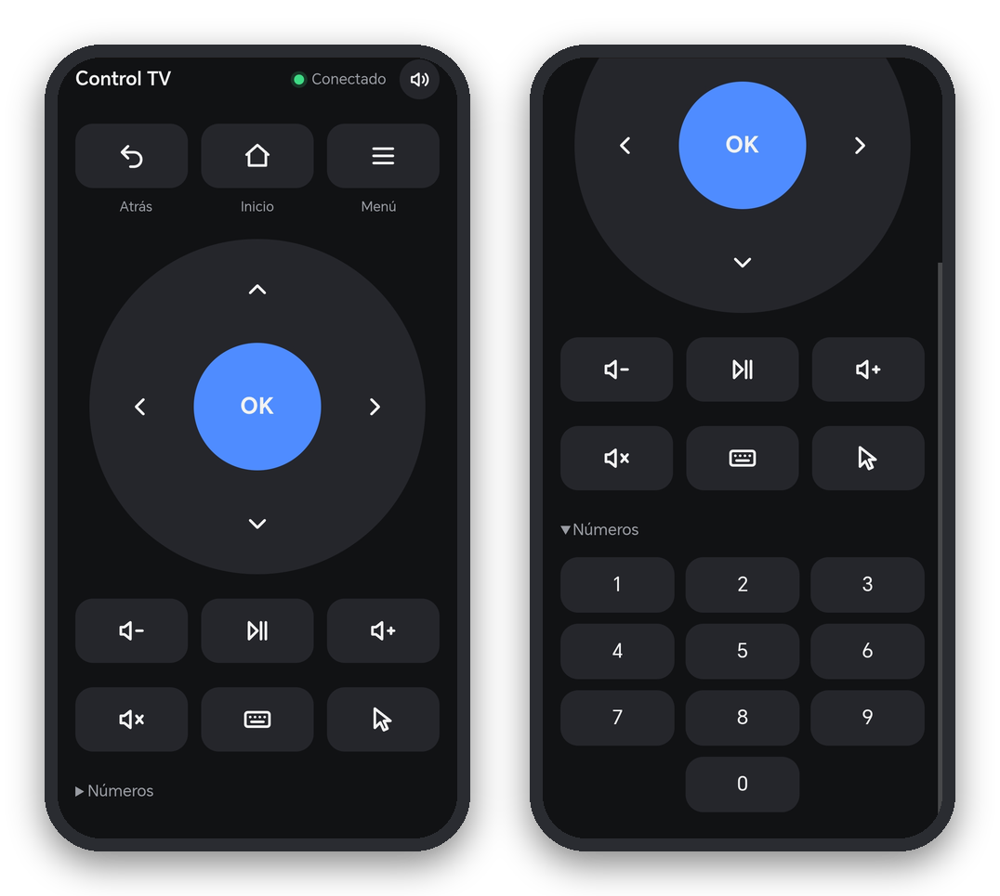

# Control TV

Control remoto web para un TV Box Android, sin publicidad y sin instalar nada en el celular.

<p align="center">
  
</p>

La caja (app **Control Web**, ~150 KB) sirve una página en `http://<IP de la caja>:8080`. Desde el
navegador del celular, en la misma red WiFi, tienes:

- **Flechas, OK, Atrás, Inicio, Menú, volumen, silencio y reproducir/pausa.** Mantener pulsado funciona.
- **Teclado:** escribes con el teclado del celular y el texto aparece en vivo en el cuadro de texto
  seleccionado en la tele (tildes, ñ y emoji incluidos). Enter busca.
- **Cursor:** muestra una flecha de mouse en la tele; las flechas la mueven (acelera si mantienes) y
  OK hace clic donde está. Útil en apps que no se manejan bien con flechas.
- **Números** 0–9.
- **Sonido de botones** (una "gota" corta generada en el celular) que se activa o desactiva con el
  ícono de altavoz; la elección se recuerda.
- **Indicador de conexión:** punto verde o rojo, comprobado cada 10 segundos mientras la página está visible.

En Chrome: ⋮ → *Agregar a la pantalla principal* para tenerlo como ícono.

Probado en una **H96 Max RK3318** (Android 10).

## Cómo funciona

| Pieza | Qué hace |
|---|---|
| `KeyService` | Servidor HTTP mínimo en el puerto 8080. Solo atiende direcciones de la red local. Arranca solo al encender (`BootReceiver`). |
| Teclas | Se escriben como eventos en `/dev/input/event0`, el receptor infrarrojo de la caja, así Android las trata igual que el control físico. OK es `KEY_REPLY` (232), que el `ff1b0030_pwm.kl` de la caja mapea a `DPAD_CENTER`. Solo se aceptan las teclas de la lista blanca (no apagado). |
| `PhoneIme` | Teclado de Android sin teclas: recibe el texto del celular y lo pone como texto en composición en el campo enfocado. |
| `CursorService` | Servicio de accesibilidad que dibuja el cursor y hace clic con un gesto en su posición. |

Escribir en `event0` funciona en esta caja porque el nodo tiene permisos `rw-rw-rw-` y SELinux viene
en *permissive* de fábrica. En un Android TV con SELinux activo no funcionaría esa parte.

## Compilar

Requiere Git Bash en Windows y un JDK 17 o superior.

```bash
KEYSTORE=/ruta/a/key.jks KS_PASS='tu-contraseña' ./build.sh
```

Usa siempre la misma llave (`key.jks`, guardada fuera del repositorio): con otra llave Android no deja
actualizar y hay que desinstalar la app primero.

El ícono se regenera con `python make_icon.py src` (necesita Pillow).

## Instalar en la caja

Con *Depuración por red* activada en Opciones de desarrollador:

```bash
adb connect <IP>:5555
adb install -r out/control-web.apk
adb shell am start-foreground-service -n com.alpha.tvcontrol/.KeyService

# Teclado del celular como teclado de la caja
adb shell ime enable com.alpha.tvcontrol/.PhoneIme
adb shell ime set com.alpha.tvcontrol/.PhoneIme

# Cursor (servicio de accesibilidad)
adb shell settings put secure enabled_accessibility_services com.alpha.tvcontrol/com.alpha.tvcontrol.CursorService
adb shell settings put secure accessibility_enabled 1
```

Para volver al teclado normal: `adb shell ime set com.android.inputmethod.latin/.LatinIME`.

Al terminar, apaga la depuración por red: `adb shell settings put global adb_enabled 0`.
